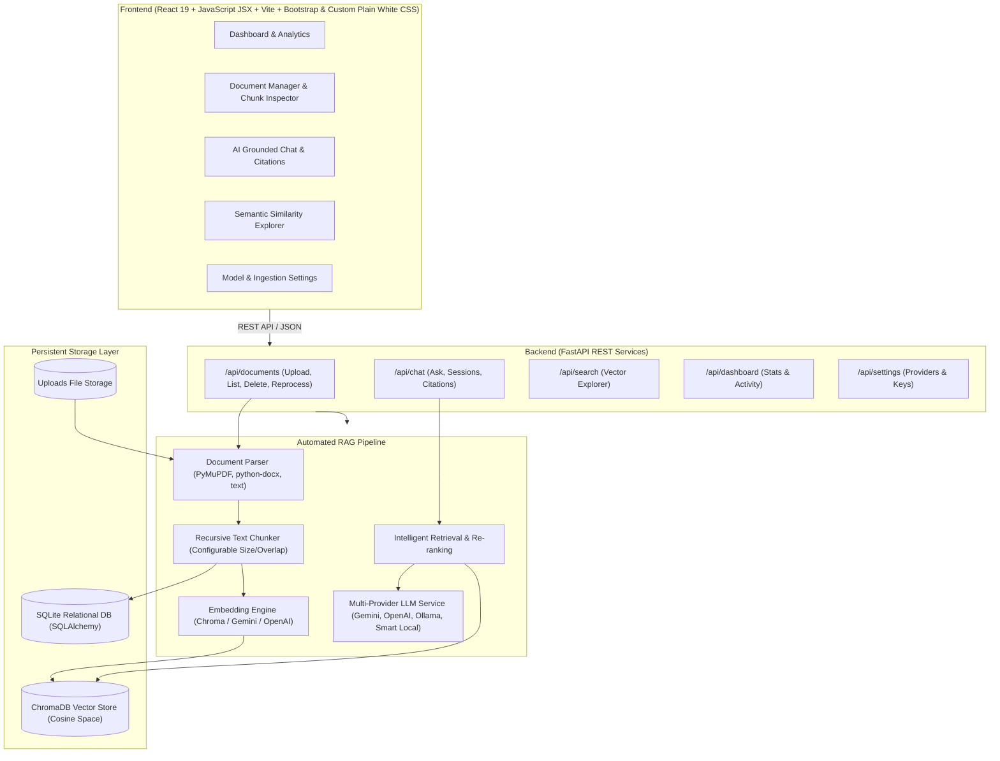

# Intelligent Knowledge Retrieval & Question Answering System Using Generative AI

A production-quality Retrieval-Augmented Generation (RAG) platform that enables users to upload enterprise documents (PDF, DOCX, TXT, Markdown), automatically parse, chunk, embed, and index their contents in a vector database, and perform natural-language question answering strictly grounded in the retrieved sources.

---

## Architecture Overview



---

## Key Features

### 1. Interactive Dashboard
- **Aggregate Metrics**: Live counts of total documents, indexed status, vector chunks, total questions answered, and conversation sessions.
- **Quick Ingestion Widget**: Drag-and-drop file upload directly from the dashboard.
- **Recent Documents**: Quick overview of recent files with status badges (`indexed`, `processing`, `error`).
- **Activity Log**: Real-time audit trail of uploads and answered questions.

### 2. Document Management & Ingestion Pipeline
- **Multi-Format Support**: Native extraction for **PDF** (via PyMuPDF), **DOCX** (via python-docx), **TXT**, and **Markdown**.
- **Batch Uploads**: Supports simultaneous multiple file uploads up to 50MB per file with format validation.
- **Intelligent Chunking**: Boundary-aware recursive splitting on paragraph, sentence, and word boundaries with configurable `chunk_size` and `chunk_overlap`.
- **Chunk Inspector Modal**: Directly view all generated chunks of any document, including page numbers, token counts, and full extracted text.
- **Document Reprocessing**: Re-index documents on demand with updated chunking settings.
- **Safe Document Deletion**: Cascades across local storage, SQLite relational records, and ChromaDB vector embeddings.

### 3. AI Question-Answering Chat Interface
- **Zero-Hallucination Grounding**: Prompt templates require the LLM to answer strictly using retrieved document context. When information is missing, the system explicitly states: *"The uploaded documents do not contain sufficient information to answer this question."*
- **Verifiable Source Citations**: Every assistant response displays source chips showing document name, page number, chunk index, and semantic similarity match percentage.
- **Source Inspector Modal**: Click any citation chip to inspect the exact passage text used to answer the question.
- **Multi-Session History**: Create, switch, rename, and clear conversation threads with persistent SQLite storage.
- **Document Scoping**: Ask questions across the entire knowledge base or restrict queries to a specific document.
- **Suggested Starter Prompts**: Instant prompt pills for newly loaded knowledge bases.
- **Copy Answer**: One-click copy with visual confirmation.

### 4. Semantic Search Explorer
- Direct vector space exploration tool to test queries against indexed embeddings.
- Live sliders for **Top-K** (1-15) and **Similarity Threshold** (0.0 - 0.9).
- Displays similarity match scores, cosine distance metrics, and chunk excerpts.

### 5. Multi-Provider Generative AI & Settings
- **Providers Supported**:
  - **Google Gemini**: Supports `gemini-2.5-flash`, `gemini-1.5-flash`, `gemini-1.5-pro` via `google-genai`.
  - **OpenAI**: Supports `gpt-4o-mini`, `gpt-4o`, `gpt-3.5-turbo` via `openai`.
  - **Ollama**: Connects to local Ollama servers (e.g. `http://localhost:11434` for Llama 3 or Mistral).
  - **Smart Local Grounded Engine**: Built-in deterministic semantic synthesizer requiring **zero external API keys**, ensuring 100% offline functionality.
- **Security**: API keys are securely saved on the backend and never exposed in client bundles.
- **Tunable RAG Hyperparameters**: Live configuration of Chunk Size (100–2000 chars), Chunk Overlap (0–300 chars), Top-K Retrieval (1–10), and Similarity Threshold (0–80%).

---

## Technology Stack

| Layer | Technologies |
|---|---|
| **Frontend** | React 19, JavaScript JSX, Vite, Bootstrap, Custom Plain White CSS, Lucide Icons, Framer Motion |
| **Backend** | Python 3.13, FastAPI, Uvicorn, Pydantic v2, Pydantic-Settings |
| **Vector Database** | ChromaDB (Persistent local storage, Cosine distance space) |
| **Relational Database** | SQLite, SQLAlchemy 2.0 ORM |
| **Document Parsers** | PyMuPDF (fitz), python-docx, UTF-8/Latin-1 text decoders |
| **Generative AI** | Google GenAI SDK, OpenAI SDK, Ollama HTTP, Built-in Extractive RAG |

---

## Directory Structure

```
SmartXWeb-genAi/
├── backend/
│   ├── app/
│   │   ├── __init__.py
│   │   ├── main.py                    # FastAPI app & lifespan handler
│   │   ├── config.py                  # App settings & storage paths
│   │   ├── database.py                # SQLAlchemy SQLite session engine
│   │   ├── models/                    # Database models (Document, Chunk, Conversation, Message, Settings)
│   │   ├── schemas/                   # Pydantic v2 validation models
│   │   ├── services/                  # RAG core (Parser, Chunker, Embedding, VectorStore, Retrieval, LLM)
│   │   └── api/                       # REST routes (documents, chat, dashboard, search, settings)
│   ├── data/                          # SQLite DB, uploads, ChromaDB storage
│   ├── tests/                         # Pytest test suite (unit + end-to-end integration)
│   ├── requirements.txt
│   └── run.py
├── frontend/
│   ├── src/
│   │   ├── api/                       # Typed fetch client
│   │   ├── components/
│   │   │   ├── Layout/                # Sidebar, Header, Theme switcher
│   │   │   ├── Dashboard/             # Metrics, Quick Upload, Activity Feed
│   │   │   ├── Documents/             # File Table, Upload Dropzone, Chunk Modal
│   │   │   ├── Chat/                  # Chat thread, Composer, Citation Cards & Modal
│   │   │   ├── Search/                # Semantic Similarity Explorer
│   │   │   └── Settings/              # Models, Keys, and Ingestion Configuration
│   │   ├── types/                     # TypeScript definitions
│   │   ├── App.tsx                    # Main app state & navigation
│   │   ├── main.tsx
│   │   └── index.css                  # Tailwind CSS v4 design system
│   ├── package.json
│   ├── vite.config.ts
│   └── tsconfig.json
├── data/sample_documents/             # Ready-to-use sample test documents
│   ├── Deep_Learning_Architectures.pdf
│   ├── Quantum_Computing_Principles.docx
│   ├── Mars_Exploration_Rover_Mission.txt
│   └── Enterprise_Cloud_Security_Policy.md
├── start_app.py                       # Unified one-command launch script
├── start.bat                          # Windows double-click launcher
└── README.md
```

---

## Quick Start Guide

### Prerequisites
- **Python 3.11+** (Tested on Python 3.13)
- **Node.js 18+** (Tested on Node 24 & npm 11)

### 1. Run with the Unified Launcher (Recommended)
From the root repository directory:
```bash
python start_app.py
```
*Or on Windows, simply double-click `start.bat`.*

This script automatically:
1. Detects `backend/venv` and boots the FastAPI server on `http://localhost:8000`.
2. Boots the Vite React development server on `http://localhost:5173`.
3. Handles graceful shutdown on `Ctrl+C`.

---

### 2. Manual Step-by-Step Setup

#### Backend Setup
```bash
# Navigate to backend directory
cd backend

# Create virtual environment (if not already created)
python -m venv venv

# Activate virtual environment
# Windows:
venv\Scripts\activate
# Linux/macOS:
source venv/bin/activate

# Install dependencies
pip install -r requirements.txt

# Start FastAPI server
uvicorn app.main:app --host 0.0.0.0 --port 8000 --reload
```
- API is available at: `http://localhost:8000`
- Interactive Swagger docs: `http://localhost:8000/docs`

#### Frontend Setup
```bash
# Open a new terminal in the frontend directory
cd frontend

# Install npm packages
npm install

# Start Vite dev server
npm run dev
```
- Frontend application is live at: `http://localhost:5173`

---

## Pre-Generated Sample Documents

Four enterprise test files are already generated in `data/sample_documents/`:
1. **`Deep_Learning_Architectures.pdf`**: 2-page document covering Transformers, Self-Attention, Positional Encodings, and RAG architectures.
2. **`Quantum_Computing_Principles.docx`**: Word document detailing Qubits, Superposition, Shor's Algorithm, and Post-Quantum Cryptography.
3. **`Mars_Exploration_Rover_Mission.txt`**: Text report covering the Perseverance Rover, Jezero Crater, MOXIE, and Ingenuity's 72 flights.
4. **`Enterprise_Cloud_Security_Policy.md`**: Security policy covering Zero Trust, FIDO2 MFA, AES-256 GCM encryption, and CMEK rotation.

You can upload these immediately in the **Documents** or **Dashboard** tabs to test the full system!

---

## Running the Automated Test Suite

The project includes unit tests for all components and an end-to-end integration test verifying file parsing, chunking, vector indexing, retrieval, QA grounding, and citation accuracy:

```bash
cd backend
.\venv\Scripts\python -m pytest tests/ -v
```

All 7 test suites pass:
- `test_document_parser_pdf`: Validates PyMuPDF multi-page text extraction.
- `test_document_parser_docx`: Validates python-docx paragraph and table extraction.
- `test_text_chunking`: Validates paragraph/sentence boundary splitting and overlap.
- `test_vector_store_and_retrieval`: Validates ChromaDB persistent indexing and similarity search.
- `test_grounded_answer_and_refusal`: Validates zero-hallucination refusal when context lacks answer.
- `test_api_workflows`: Validates upload, stats, chat, and settings endpoints.
- `test_full_e2e_rag_workflow`: End-to-end integration across PDF, DOCX, and TXT files.

